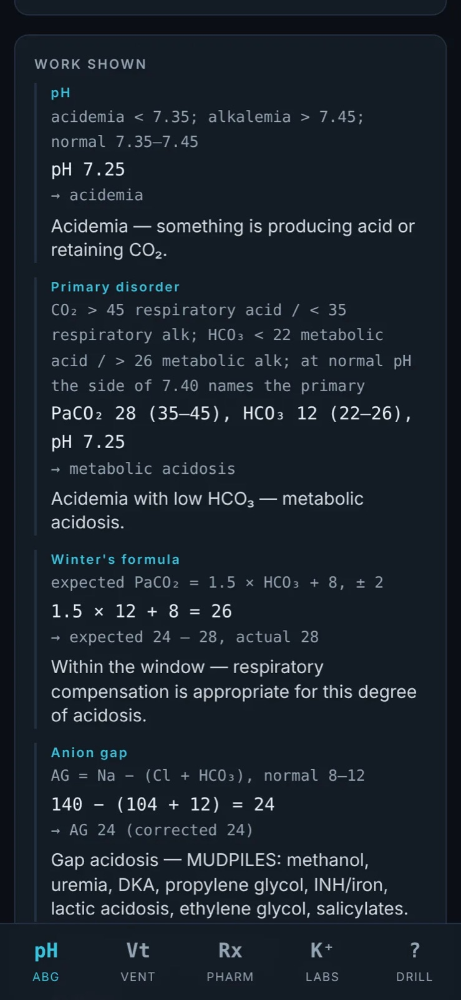
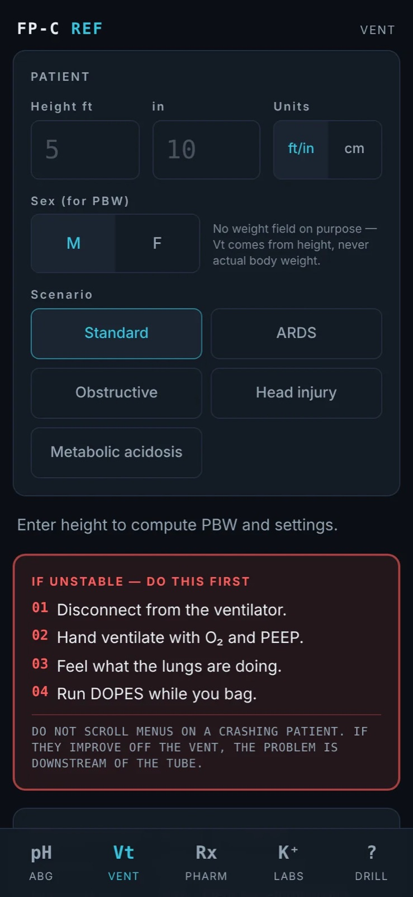
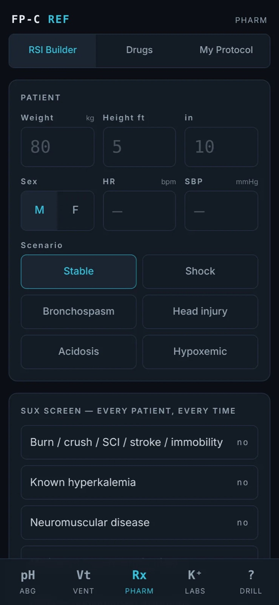

# Preflight

**Offline study reference for flight-paramedic (FP-C) exam preparation.**

`Web app (PWA) and Android in development`

---

An offline-capable study reference for flight paramedics that calculates, interprets and teaches: every answer shows the formula, the substitution, the expected window and the verdict. A study reference, not a clinical decision tool.

## Highlights

- ABG interpretation engine
- Ventilator calculations (PBW, presets, ARDSNet PEEP)
- Pharmacology: RSI builder and drug cards
- Labs, EKG changes and calculators
- Question drill scored against the exam cut score

## Platforms & stack

| Platform | Stack |
|---|---|
| Web (PWA) | React 19, Vite, TypeScript, Tailwind CSS 4, vite-plugin-pwa, IndexedDB |
| Android | Kotlin, Jetpack Compose, Material 3 |

## Screenshots

ABG interpretation with the work shown

Ventilator calculations

Pharmacology

---

This repository is a public showcase: documentation and media only. The source code is proprietary and lives in a private repository.

© 2026 Esteban Ibarra. All rights reserved. See [NOTICE](NOTICE). · [More projects](https://github.com/esteban572) · [estebanibarra.dev](https://www.estebanibarra.dev)
